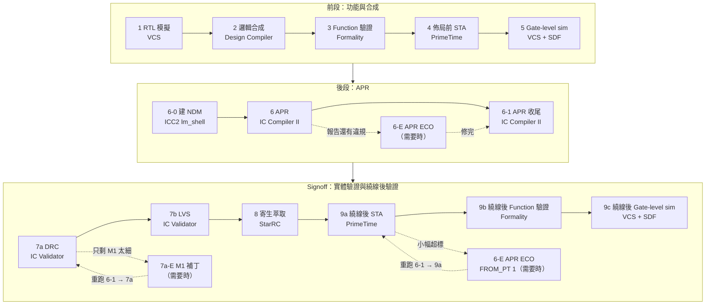

# ic-flow-template

數位 IC（cell-based）設計流程的公版腳本，從 RTL 到 GDS，每個階段一份 `.tcl`／`.sh`。

給學習者用：把公版複製到自己的專案，照每個檔頭的【要改的地方】修改，自己執行，再照【跑完看什麼】讀報告、判斷有沒有通過。公版刻意不做一鍵跑完，看懂每一步、從報告找問題、決定下一步，是這個流程要練的。

它同時是一個標準格式的 skill（`SKILL.md` 加上腳本），支援 skill 的 AI 程式助手可以照這份內容回答流程問題、幫忙看腳本。

## 流程



實線是每次都要跑的主流程，虛線是報告有問題時才跑的修正回圈。

| # | 階段 | 什麼時候跑 | 工具 | 公版（`templates/` 底下） | 怎樣算通過 |
|:---:|---|:---:|---|---|---|
| 1 | RTL 模擬 | 必跑 | VCS | `01_rtl_sim/run_rtl_sim.sh` | tb 印出 PASS，mismatch = 0 |
| 2 | 邏輯合成 | 必跑 | Design Compiler | `02_syn/dc_syn.tcl`、`constraints.sdc` | setup slack ≥ 0，沒有 VIOLATED |
| 3 | Function 驗證 | 必跑 | Formality | `03_fm/fm_rtl2gate.tcl` | `Verification SUCCEEDED` |
| 4 | 佈局前 STA | 必跑 | PrimeTime | `04_sta/pt_sta.tcl` | 三個 corner slack ≥ 0，沒有 VIOLATED |
| 5 | Gate-level sim | 必跑 | VCS + SDF | `05_gate_sim/run_gate_sim.sh` | 功能 PASS、SDF 0 error、沒有 timing violation |
| 6-0 | 建 NDM | 必跑 | ICC2 lm_shell | `06_apr/build_ndm.tcl` | 沒有 Error（同一製程只要建一次） |
| 6 | APR | 必跑 | IC Compiler II | `06_apr/apr.tcl` | 0 繞線 DRC／open、電源沒浮接、沒有 VIOLATED |
| 6-E | APR ECO | 需要時 | IC Compiler II | `06_apr/apr_eco.tcl` | 0 繞線 DRC、沒有 VIOLATED |
| 6-1 | APR 收尾 | 必跑 | IC Compiler II | `06_apr/apr_finish.tcl` | GDS、netlist 有產生，仍是 0 DRC |
| 7a | DRC | 必跑 | IC Validator | `07_drc_lvs/run_drc.sh` | `RESULTS: CLEAN` |
| 7a-E | M1 補丁 | 需要時 | IC Compiler II | `06_apr/apr_m1_patch.tcl` | 重跑 6-1 與 7a 後 CLEAN |
| 7b | LVS | 必跑 | IC Validator | `07_drc_lvs/run_lvs.sh` | `Final comparison result:PASS` |
| 8 | 寄生萃取 | 必跑 | StarRC | `08_pex/run_starrc.sh` | 三個 corner 的 SPEF 有產生 |
| 9a | 繞線後 STA | 必跑 | PrimeTime | `09_postroute/pt_postroute.tcl` | 三個 corner slack ≥ 0，沒有 VIOLATED |
| 9b | 繞線後 Function 驗證 | 必跑 | Formality | `09_postroute/fm_postroute.tcl` | `Verification SUCCEEDED` |
| 9c | 繞線後 Gate-level sim | 必跑 | VCS + SDF | `05_gate_sim/run_gate_sim.sh`（`POSTROUTE=1`） | 同第 5 步 |

### 每個階段在做什麼

**前段：確認功能正確，並把 RTL 變成邏輯閘**

- **1 RTL 模擬**：用題目給的 testbench 跑你寫的 Verilog，確認功能對。這是之後每一步的比較基準。
  輸入 RTL、tb → 輸出 log、波形（用 Verdi 看）。
- **2 邏輯合成**：Design Compiler 依照時序約束（SDC），把 RTL 換成製程的標準元件（AND、OR、DFF…）連成的 gate-level netlist，同時讓電路在時脈週期內跑得完。
  輸入 RTL、SDC、元件時序檔（.db）→ 輸出 netlist、SDF（元件延遲）、SVF（給 Formality 的改寫紀錄）。
- **3 Function 驗證**：合成工具會大幅改寫電路，Formality 不跑模擬，而是用數學方法證明 netlist 和 RTL 在所有輸入下功能都一樣。
  輸入 RTL、netlist、SVF → 輸出比對報告。
- **4 佈局前 STA**：PrimeTime 把每一條訊號路徑的延遲都算一遍，檢查 slow／typical／fast 三種條件下 setup（來不來得及）和 hold（會不會太快）是否都滿足。這時線延遲還是估計值。
  輸入 netlist、SDC → 輸出時序報告、每個 corner 的 SDF。
- **5 Gate-level sim**：netlist 加上 SDF 的元件延遲，再跑一次 testbench，確認帶真實延遲時功能還對、沒有 setup／hold 違規。
  輸入 netlist、SDF、tb → 輸出 log。

**後段 APR：把邏輯閘擺到晶片上、用金屬線連起來**

- **6-0 建 NDM**：把標準元件的時序檔（.db）和外框檔（LEF）打包成 IC Compiler II 用的 library（NDM）。同一個製程只要建一次。
- **6 APR**：floorplan（決定晶片大小）→ 電源網路 → 擺放元件 → 長時脈樹（CTS）→ 繞線。每一步存一個 block，出錯可以從上一步重來。
  輸入 netlist、NDM、SDC → 輸出 routed block。
- **6-E APR ECO（需要時）**：APR 報告還有 max_capacitance／max_transition（某條線負載太大、訊號變化太慢）違規，或繞線還有 DRC 時才跑：讀報告，在推不動的線前面插 buffer。`FROM_PT 0` 讀 ICC2 的報告；繞線後 STA（9a）才發現小幅超標時改成 `FROM_PT 1` 讀 PT 的報告。
- **6-1 APR 收尾**：補 filler 元件把空位填滿，輸出 GDS 版圖和 netlist（一份給時序用、一份含電源接腳給 LVS 用）。

**Signoff：確認做得出來、而且電路沒有變**

- **7a DRC**：IC Validator 依製程規則逐條檢查 GDS：線寬、間距、密度…違反規則工廠就做不出來。
  輸入 GDS → 輸出錯誤清單。
- **7a-E M1 補丁（需要時）**：DRC 只剩 M1 金屬太細的錯誤時，在 ICC2 裡把那幾段補寬，再重跑 6-1 和 7a。
- **7b LVS**：從版圖萃取出電晶體和連線，和 netlist 逐一比對，確認畫出來的就是你設計的電路。
  輸入 GDS、netlist → 輸出比對結果。
- **8 寄生萃取**：StarRC 從版圖算出每一條金屬線實際的電阻和電容，三種條件各寫一份 SPEF。
  輸入 routed block → 輸出 SPEF ×3。
- **9a 繞線後 STA**：用 SPEF 的實際線延遲重算時序，這才是最後算數的結果。還有小幅超標就回 6-E（`FROM_PT 1`），再從 6-1 重跑到 9a。
  輸入繞線後 netlist、SPEF → 輸出時序報告、繞線後 SDF。
- **9b 繞線後 Function 驗證**：APR 加了時脈樹和 buffer，netlist 又被改過，所以再證明一次功能和 RTL 相同。
- **9c 繞線後 Gate-level sim**：用繞線後的 netlist 和實際延遲的 SDF 再跑一次 testbench，最後確認功能。

每個階段的細節、為什麼要做、省略會怎樣，見 `SKILL.md`；遇到錯誤先查 `references/pitfalls.md`；縮寫對照在 `references/glossary.md`；想加 IO PAD 做成完整晶片，見 `references/pad.md`。

## 安裝與使用

```bash
git clone https://github.com/charlesHYC/-ic-flow-template.git
```

1. 把 `templates/` 底下的檔案複製到自己專案的 `scripts/`。
2. 先改 `common_setup.tcl`（top 名稱、RTL 檔案、clock、週期、PDK 路徑），再依序改每個階段檔頭標示的地方。
3. 一個階段一個階段執行（每支腳本檔頭的【執行】寫了指令），每一步都看報告確認通過再往下。

當成 skill 使用時，把整個 repo 放到 AI 助手讀取 skill 的目錄，例如：

```bash
git clone https://github.com/charlesHYC/-ic-flow-template.git ~/.claude/skills/ic-flow-template
```

## 檔案結構

```
SKILL.md                            流程總覽、每階段的通過標準、回答原則
templates/
  common_setup.tcl                  共用設定（所有 tcl 第一行 source）
  01_rtl_sim/run_rtl_sim.sh
  02_syn/dc_syn.tcl  constraints.sdc
  03_fm/fm_rtl2gate.tcl
  04_sta/pt_sta.tcl
  05_gate_sim/run_gate_sim.sh       佈局前；POSTROUTE=1 為繞線後
  06_apr/build_ndm.tcl  apr.tcl  apr_eco.tcl  apr_finish.tcl  apr_m1_patch.tcl
  07_drc_lvs/run_drc.sh  run_lvs.sh
  08_pex/run_starrc.sh
  09_postroute/pt_postroute.tcl  fm_postroute.tcl
references/
  pitfalls.md                       常見錯誤與手動修法
  glossary.md                       縮寫與名詞對照
  pad.md                            IO PAD 說明（公版不含 PAD 腳本，這份說明要自己做時怎麼做）
```

## 需求與限制

- Synopsys 工具：VCS、Design Compiler、Formality、PrimeTime、IC Compiler II、IC Validator、StarRC。
- 製程預設 SAED32 EDK（RVT，三個 corner）。PDK 路徑寫在 `common_setup.tcl` 與幾支 `.sh` 的檔頭，請改成自己環境的位置。製程檔不包含在這個 repo 裡。
- 只做核心，不含 IO PAD 的腳本；PAD 的觀念與做法見 `references/pad.md`。完整可以跑的 PAD 流程在 [IC_flow_skill](https://github.com/charlesHYC/IC_flow_skill)。
- CBDK_IC_Contest 製程的改法寫在 `SKILL.md`，但沒有實際跑過。

## 驗證狀態

2026-11-17 用 REFRACT（2026 IC Contest 題目，SAED32、clock 50 ns）照上面的順序一個階段一個階段跑完，每個階段都通過：

- DRC `RESULTS: CLEAN`（M1 補丁 1 輪）、LVS `Final comparison result:PASS`。
- 繞線後 STA 三個 corner 沒有 VIOLATED：setup slow／typical／fast = +36.17／+42.10／+45.69 ns，hold +0.223／+0.088／+0.004 ns（APR ECO 先用 `FROM_PT 0` 跑 1 輪；繞線後 STA 還有小幅 max_cap／transition 超標，再用 `FROM_PT 1` 修 2 輪，分別插 15 顆、1 顆 buffer）。
- 繞線後 Function 驗證（Formality）`Verification SUCCEEDED`、slow／fast 繞線後 Gate-level sim PASS。
- tie cell 有插入（繞線後 netlist 有 `TIEL_RVT`）。

這次驗證找到並修正兩個公版問題，寫在 `references/pitfalls.md`：

- `apr.tcl`：SAED32 的 TIEH／TIEL 是 dont_use、dont_touch，原本 `add_tie_cells` 一顆都插不進去（OPT-200）。
- `apr_eco.tcl`：PT 把很小的違規印成 `(VIOLATED: increase significant digits)`，原本讀不到，會漏修。

## 授權

MIT License，見 `LICENSE`。
